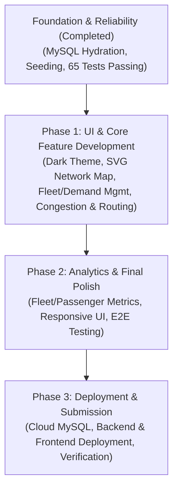

# Smart Public Transportation Route Optimization — Master Project Blueprint

**Document Version:** 2.0  
**Status:** Active Architectural Blueprint  
**Last Revised:** Post-Implementation Audit (Post-Audit Roadmap Revision)  
**Target Environment:** Java 21, Spring Boot 4.1.1, React 19 + Vite, MySQL 8.0.46, Maven Wrapper  

---

## 1. Project Vision & Problem Formulation

### 1.1 The Urban Challenge
In rapidly developing urban corridors such as the municipal scenario of Vetrinagar, public transport networks suffer from acute operational strain during peak hours, sudden traffic surges, and unexpected vehicle breakdowns. Key challenges include:
- **Corridor Demand Surges:** High-density passenger batches form at critical transfer hubs, overwhelming scheduled transit lines.
- **Narrow Infrastructural Bottlenecks:** Historic urban zones and high-density corridors feature narrow roads inaccessible to standard 50-passenger buses, requiring specialized 25-passenger mini-buses.
- **Dynamic Traffic Disruption:** Peak-hour congestion, road maintenance, and accidents dynamically alter travel times, rendering static timetables obsolete.
- **Disruption Fragility:** When a bus breaks down in transit, stranded passengers face indeterminate delays because existing fleet systems lack real-time re-queuing and automated emergency relief dispatch.

### 1.2 System Purpose & Objectives
The **Smart Public Transportation Route Optimization System** is an enterprise-grade dispatch and route optimization platform. It combines:
1. **Algorithmic Route Optimization:** Custom travel-time Dijkstra routing over a dynamically weighted road network, enforcing vehicle-specific road restrictions.
2. **Dual-Tier Demand Management:** A hybrid queue architecture enforcing strict corridor FIFO order alongside global passenger batch prioritization.
3. **Capacity-Aware Fleet Dispatch:** Greedy multi-leg dispatch (depot/current position $\to$ pickup $\to$ destination) that maximizes seat utilization without exceeding vehicle capacity.
4. **Relational Audit & State Persistence:** Production-ready relational persistence in MySQL 8.0.46 for simulation tracking, auditability, and historical analytics.
5. **Real-Time Interactive Operations Dashboard:** High-responsiveness web application providing live fleet monitoring, interactive route planning, and simulated incident management.

---

## 2. Streamlined Three-Phase Upgrade & Deployment Roadmap

To prioritize demonstrable college evaluation, portfolio presentation, and free-tier cloud deployment, the upgrade execution plan is organized into three consolidated, high-impact phases. This builds upon the verified foundation (Phase 0: Database Hydration, Seeding & Consistency, passing 65 automated tests).

### PHASE 1 — UI AND CORE FEATURE DEVELOPMENT
*Goal: Deliver a professional, interactive dark-themed operations dashboard and SVG transit visualizer, integrating routing, traffic control, and fleet/demand management on top of existing backend capabilities.*

1. **Professional Dark Charcoal & Orange Dashboard:**
   - Establish modern dark design system (charcoal surfaces `#111317` / `#1a1d24`, vibrant orange accents `#ea580c` / `#f97316`, neutral slate borders `#2d323e`, off-white typography `#f3f4f6`).
2. **Modular React Architecture:**
   - Decompose monolithic UI into clean, reusable components (`components/map/`, `components/routing/`, `components/traffic/`, `components/fleet/`, `components/demand/`, `components/ui/`).
3. **Interactive SVG Transportation Network:**
   - Responsive vector map rendering all 13 Vetrinagar stops laid out topologically, with directional arrows, stop badges, and road type styling (solid for primary, dashed for narrow).
4. **Bus Location & Route Visualization:**
   - Render live bus markers positioned at current stops with occupancy gauges, operational status indicators, and illuminated path overlays for active trips.
5. **Congestion Controls & Road Closures:**
   - Interactive UI controls allowing operators to adjust road travel times (1.0x to 4.0x multiplier) and toggle temporary road closures, dynamically updating the network graph.
6. **Route Comparison & Optimization Interface:**
   - Origin/destination selector with Dijkstra minimum travel-time calculation, side-by-side alternative route comparison, estimated travel time and distance, and step-by-step route breakdown.
7. **Fleet Management & Dynamic Passenger Demand Creation:**
   - Fleet status controls (toggling buses between `AVAILABLE`, `MAINTENANCE`, `OUT_OF_SERVICE`).
   - Dynamic passenger demand creation form to inject custom passenger batches directly into the live demand queue.

---

### PHASE 2 — ANALYTICS AND FINAL POLISH
*Goal: Provide executive analytics, comprehensive error resilience, responsive device design, and end-to-end integration polish.*

1. **Passenger & Fleet Analytics:**
   - Passenger state metrics (waiting, in-transit, completed) with strict conservation tracking.
   - Fleet capacity utilization percentages and individual bus occupancy meters.
2. **Accurate Performance Metrics:**
   - Algorithmic execution latency benchmarking (Dijkstra computation in $\mu s$), distance traveled, and service rate indicators.
3. **Responsive Desktop & Mobile UI:**
   - Flexible responsive dashboard layout supporting mobile, tablet, and widescreen projection displays.
4. **Loading, Error & Empty States:**
   - Resilient UX feedback including connection latency monitoring, backend wake-up banners, loading spinners, and graceful empty state placeholders.
5. **End-to-End Integration Testing & Bug Fixes:**
   - Comprehensive automated frontend and backend testing, validating that all actions update state consistently and conserve passengers.
6. **Final Polish & UI Refinements:**
   - Smooth transitions, micro-interactions, clean table pagination/scrolling, and consistent typography.

---

### PHASE 3 — DEPLOYMENT AND SUBMISSION
*Goal: Deploy the full-stack system onto reliable free-tier cloud hosting and prepare all demonstration materials.*

1. **Free-Tier Hosting Evaluation & Setup:**
   - Configure frontend static hosting (Vercel / Netlify / Cloudflare Pages) and backend container service (Render / Koyeb).
2. **Cloud MySQL Database Configuration:**
   - Provision cloud MySQL instance (Aiven / TiDB Cloud Serverless) using encrypted SSL JDBC connections and existing schema.
3. **Spring Boot Backend Deployment:**
   - Containerize and configure JVM memory optimization (`-XX:+UseSerialGC -Xmx256m`) to run within free-tier 512MB RAM constraints.
4. **React Frontend Deployment:**
   - Deploy production build to CDN with API proxy/CORS configuration.
5. **Environment Variables & Production Hardening:**
   - Secure database credentials and production URLs using environment variables.
6. **Public Deployment Verification:**
   - End-to-end operational check on live cloud URLs: verify database seeding, route planning, allocation runs, and interactive controls.
7. **README, Screenshots & Demonstration Preparation:**
   - Comprehensive project documentation, architectural diagrams, video/GIF walkthroughs, and presentation slides for college submission.

---

## 3. Critical System Invariants

The following architectural and algorithmic invariants are inviolable. Any pull request, refactoring, or feature implementation that violates these rules must be rejected:

1. **Passenger Conservation:**
   $$\text{Total System Passengers} = \text{Waiting Passengers} + \text{In-Transit Passengers} + \text{Completed Passengers}$$
   No passenger batch or remainder batch may be discarded, duplicated, or untracked during any lifecycle transition, including partial boarding, route completion, and emergency breakdown recovery.
2. **Strict Corridor FIFO:**
   For any two demand requests $D_1$ and $D_2$ sharing the exact same pickup and destination stop:
   $$\text{arrivalOrder}(D_1) < \text{arrivalOrder}(D_2) \implies D_1 \text{ must be allocated and boarded before or with } D_2$$
   A larger batch arriving later can never overtake an earlier batch on the same corridor. Remainder batches created via partial boarding (`-rem`) retain their original arrival order and timestamp.
3. **Capacity Invariant:**
   For any bus $B$ at any instant $t$:
   $$\text{currentOccupancy}(B) \le \text{seatCapacity}(B)$$
   Standard buses are strictly bounded at 50 seats; Mini buses are strictly bounded at 25 seats. Overbooking is strictly forbidden.
4. **Road Accessibility Restrictions:**
   For any road $R$ where $\text{roadType}(R) == \text{MINIBUS\_ONLY}$:
   $$\text{StandardBus.canUseRoad}(R) == \text{false}$$
   Standard buses must never be routed or dispatched across roads restricted to mini-buses.
5. **Routing Baseline Optimality:**
   The existing Dijkstra implementation in `RoutePlanner` must continue to optimize **total travel time in minutes** (not spatial distance) using a priority queue min-heap when operating in baseline shortest-time mode.
6. **Trip Lifecycle Integrity:**
   - Trips marked `IN_PROGRESS` cannot be reassigned or duplicated as though they were waiting requests.
   - Breakdown recovery must be implemented as a separate, explicitly validated workflow (cancel trip, de-board passengers to stop, re-queue with emergency priority, dispatch relief).
7. **Database Consistency & State Synchronization:**
   Persisted state in MySQL and in-memory state in the simulation engine must follow an explicit, deterministic synchronization lifecycle. Application bootstrap must rehydrate directly from persisted records.

---

## 4. Architectural Rules and Coding Standards

1. **Encapsulation of Core Algorithms:**
   - Core routing (`RoutePlanner`), queue management (`DemandQueueService`), and graph topology (`RoadNetwork`) must remain pure Java domain components free of direct Spring Web or HTTP annotations.
2. **Polymorphic Fleet Design:**
   - Vehicle capabilities, road access restrictions, and capacity limits must be evaluated polymorphically via `Bus` abstractions (`StandardBus` vs `MiniBus`) rather than hardcoded type checks or conditional branching.
3. **Deterministic Persistence:**
   - Database entities in `com.transport.backend.entity` must maintain strict relational constraints (foreign keys, cascading policies, non-nullable constraints) verified against MySQL 8.0.46.
4. **No Premature Implementation:**
   - Features belonging to future phases must not be implemented until their prerequisite phases are completed and fully verified with automated tests.

---

## 5. Development and Testing Protocol

1. **Test-Driven / Test-Verified Execution:**
   - Every algorithmic enhancement must be accompanied by unit tests covering boundary conditions, empty queues, disconnected graphs, and capacity saturations.
2. **Zero Regressions Standard:**
   - The entire automated backend test suite (77 automated unit, persistence, and controller tests) must pass before and after any code modification.
3. **Database Test Isolation:**
   - Persistence tests must use dedicated isolated test contexts (e.g., in-memory H2 with MySQL syntax compatibility or containerized MySQL) ensuring local development databases are not corrupted during test runs.
4. **Frontend Verification:**
   - Frontend modifications must pass compilation (`npm run build`), linting checks, and automated component tests before integration.
