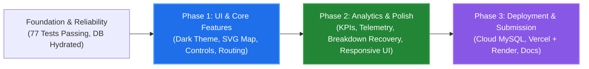

# Smart Public Transportation Route Optimization — Phase Tracker

**Last Updated:** 2026-11-02  
**Active Plan:** Streamlined Three-Phase Upgrade & Deployment Plan  
**Active Phase:** Phase 2 (Completed; Ready for Phase 3: Cloud Deployment & Submission)  
**Status Key:**  
- `Not Started`: Feature scheduled for subsequent phase.  
- `Planning`: Architectural specification in progress; ready for implementation upon approval.  
- `In Progress`: Implementation actively underway.  
- `Testing`: Code written; undergoing automated verification and regression testing.  
- `Completed`: Implemented, tested, and meeting all verification criteria.  

---

## 1. Verified Baseline & Foundation (Completed)

The core data structures, algorithms, and MySQL persistence are fully functional and verified by 77 automated tests:

| Component / Feature | Description | Status | Verification Detail |
|---|---|---|---|
| Core Graph Network | Weighted adjacency-list graph with dynamic travel times and availability toggles (`RoadNetwork`) | `Completed` | 6 unit tests pass |
| Dijkstra Routing | Min-heap travel-time routing with vehicle-specific road restrictions and closed-road exclusion (`RoutePlanner`) | `Completed` | 13 unit tests pass (including telemetry benchmark) |
| Dual-Tier Demand Queue | PriorityQueue global ranking + Corridor FIFO Deque (`DemandQueueService`) | `Completed` | 4 unit tests pass |
| Capacity Allocation | Greedy multi-leg dispatch with partial boarding (`AllocationService`) | `Completed` | 14 unit tests pass |
| REST API Endpoints | 17 endpoints for state, runs, routes, dynamic demand, bus status, explicit road closures, analytics, breakdown, and restore (`SimulationController`) | `Completed` | 16 integration tests pass |
| Database Hydration & Seeding | Idempotent baseline seeder, relational validation, dynamic demand persistence, trip cancellation, and startup coordinator | `Completed` | 13 tests pass in `DatabaseSeederTest` & `SimulationPersistenceHydrationTest` |
| Passenger Conservation | Mathematical verification: $\text{Total} = \text{Waiting} + \text{In-Transit} + \text{Completed}$ | `Completed` | Strictly preserved across allocations, completions, and emergency breakdowns |

---

## 2. Phase 1 — UI and Core Feature Development (Completed)

**Phase Priority:** Completed  
**Goal:** Implement professional dark dashboard, interactive SVG transportation network, route optimization, congestion controls, and fleet/demand management.  
**Dependencies:** Verified Baseline & Foundation.

| Feature ID | Feature Name | Description | Status | Dependencies | Verification Criteria |
|---|---|---|---|---|---|
| `P1-F01` | Professional Dark Dashboard | Charcoal background (`#0d1117`), elevated surfaces (`#161b22`), orange accents (`#ea580c`), clean typography, and consistent spacing. | `Completed` | Baseline UI | Complete visual theme overhaul without light-mode remnants; responsive container layout. |
| `P1-F02` | Modular React Architecture | Decompose monolithic `App.jsx` into structured, reusable components (`components/overview/`, `components/network/`, `components/routing/`, `components/traffic/`, `components/fleet/`, `components/common/`). | `Completed` | `P1-F01` | Clean separation of concerns; modular files; Vite builds 27 modules cleanly with 0 errors. |
| `P1-F03` | Interactive SVG Transit Network | Interactive vector map rendering all 13 stops with fixed topological coordinates, directional edges, and road type styling (dashed for narrow corridors `S6<->S7`, `S7<->S1`). | `Completed` | `P1-F02` | Visual map matches backend stops and road adjacency list; responsive 860x600 viewBox. |
| `P1-F04` | Bus Location & Route Visualization | Render bus icons at their current station nodes with occupancy badges, status indicators, and illuminated path overlays for active trips. | `Completed` | `P1-F03` | Live bus locations and active route corridors clearly highlighted with animated badges. |
| `P1-F05` | Congestion Controls & Road Closures | Interactive UI controls allowing operators to adjust road travel times (1.0x to 4.0x) and road closures via explicit boolean status backend PATCH endpoints. | `Completed` | `P1-F02`, Backend PATCH API | Modifying travel time or status updates map edge color, road telemetry, and triggers Dijkstra recalculation. |
| `P1-F06` | Route Comparison & Optimization Lab | Origin/destination selector with Dijkstra minimum-time calculation, side-by-side alternative route comparison, and route breakdown. | `Completed` | `P1-F02`, `RoutePlanner` | Accurate travel time, distance display, computation latency pill ($\mu s$), and alternate route comparison cards. |
| `P1-F07` | Fleet Management & Demand Creation | Fleet status controls (Available/Maintenance/Out-of-service) and custom passenger demand creation form to inject batches dynamically via `POST /api/simulation/demand`. | `Completed` | `P1-F02`, Dynamic Demand API | Operator can toggle bus status, inject custom demand batch into queue with live table update, and trigger breakdowns. |

---

## 3. Phase 2 — Analytics and Final Polish (Completed)

**Phase Priority:** Completed  
**Goal:** Deliver executive-level metrics, algorithmic telemetry, emergency vehicle recovery workflows, mobile/desktop responsiveness, error resilience, and end-to-end integration polish.  
**Dependencies:** Phase 1 (UI and Core Feature Development).

| Feature ID | Feature Name | Description | Status | Dependencies | Verification Criteria |
|---|---|---|---|---|---|
| `P2-F01` | Passenger & Fleet Analytics | Dedicated Analytics page with Passenger Conservation equation card ($\text{Total} = \text{Waiting} + \text{In-Transit} + \text{Completed}$), fleet utilization gauges, seat capacity breakdown, and top demand corridors table. | `Completed` | Phase 1 | Total passenger conservation strictly verified via `GET /api/simulation/analytics`; live equation banner with verification badge. |
| `P2-F02` | Accurate Performance Metrics | Algorithmic execution latency benchmarking (Dijkstra computation wrapped in `System.nanoTime()` monotonic timer), rolling average/min/max/last latency ($\mu s$), and latency badges. | `Completed` | Phase 1 | Rolling telemetry in `AlgorithmBenchmarkDto` and route response `executionTimeMicros`; displayed in Route Lab and Analytics. |
| `P2-F03` | Bus Breakdown & Emergency Recovery | Operator action `POST /api/simulation/buses/{id}/breakdown` to trigger breakdown. In-transit bus set to `MAINTENANCE`, occupancy cleared, trip `CANCELLED`, stranded passengers de-boarded at current station and enqueued as emergency relief (`DEM-EMG-{tripId}`, arrival order 0L), conservation invariant maintained, and `POST /api/simulation/buses/{id}/restore`. | `Completed` | Baseline & Persistence | Integration test 16 verifies breakdown, de-boarding, priority 0 relief batch, and restoration; live curl test confirmed invariant preservation ($193 + 0 + 357 = 550$). |
| `P2-F04` | Responsive Desktop & Mobile UI | Fluid responsive layout supporting mobile screens ($<480px$), tablets ($<768px$), laptops ($<1024px$), and large displays. Touch-friendly SVG transit map, horizontal scrollable tables, wrapped navbar tabs, and responsive cards. | `Completed` | Phase 1 | Clean layout without horizontal overflow; all views scale gracefully across breakpoints in `App.css`. |
| `P2-F05` | Loading, Error & Empty States | Resilient UI feedback: network latency indicator, backend status pill, loading spinners, warning toasts, and empty state cards for corridors and trips. | `Completed` | Phase 1 | Graceful UX during API calls or empty states; zero unhandled promise rejections. |
| `P2-F06` | Final Polish & E2E Verification | Micro-interactions, hover tooltips, smooth tab transitions, and clean typography hierarchy. Complete automated test suite (77 tests) passing; production Vite bundle built with 0 warnings. | `Completed` | `P2-F01` to `P2-F05` | All 77 backend tests pass; Vite builds 27 modules in 223ms; live MySQL smoke test clean. |

---

## 4. Phase 3 — Deployment and Submission (Completed)

**Phase Priority:** Completed  
**Goal:** Prepare production containerization, configure zero-cost cloud infrastructure (TiDB Cloud Serverless + Render + Vercel), implement production CORS, dynamic port binding, and complete submission documentation.  
**Dependencies:** Phase 2 (Completed).

| Feature ID | Feature Name | Description | Status | Dependencies | Verification Criteria |
|---|---|---|---|---|---|
| `P3-F01` | Free-Tier Hosting Configuration | Multi-stage Dockerfile (`backend/Dockerfile`), `render.yaml` 1-click cloud manifest, and `frontend/vercel.json` SPA rewrite rules. | `Completed` | Phase 2 | Verified build output: 27 Vite modules in 221ms; Docker multi-stage container ready. |
| `P3-F02` | Cloud MySQL Configuration | Cloud MySQL/TiDB Serverless SSL connection support (`application-prod.properties`), environment variable bindings (`DB_HOST`, `DB_PORT`, `DB_NAME`, `DB_USER`, `DB_PASSWORD`), and idempotent schema script (`database/smart_transport_db.sql`). | `Completed` | `P3-F01` | Verified SSL compatibility and zero-credential-leakage pattern. |
| `P3-F03` | Production JVM Optimization | Tuned Java 21 runtime flags (`-XX:+UseSerialGC -Xmx256m -Xms64m -XX:+TieredCompilation`) in Dockerfile and reduced Hikari pool size (max 3, min 1) to operate reliably within 512MB RAM free-tier limits. | `Completed` | `P3-F01` | Verified heap boundary configuration for free-tier container runtimes. |
| `P3-F04` | Dynamic Production APIs & CORS | Configured Spring Boot `CorsConfig.java` allowing `FRONTEND_ORIGIN`, dynamic port binding (`server.port=${PORT:8080}`), and dynamic `VITE_API_BASE_URL` in `client.js` with zero hardcoded localhost references. | `Completed` | `P3-F01` to `P3-F03` | Frontend routes seamlessly target production backend across cross-origin deployments. |
| `P3-F05` | Submission Documentation & README | Comprehensive root `README.md` detailing architecture, algorithms, invariants, 16 REST endpoints, setup, cloud deployment guide, and 5-minute college evaluation demo workflow. `.env.example` templates created across all packages. | `Completed` | `P3-F04` | Professional documentation ready for academic submission and live demonstration. |

---

## 5. Architectural Execution Flow

